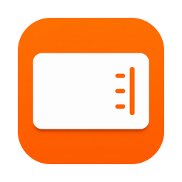
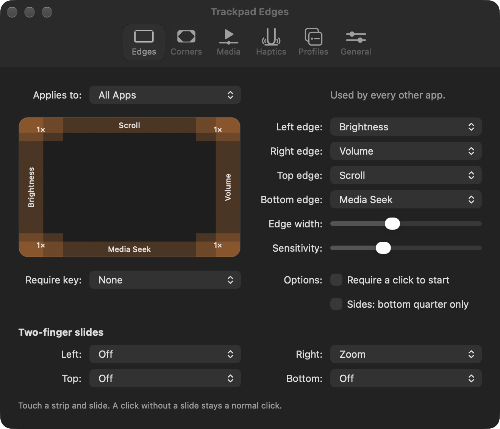
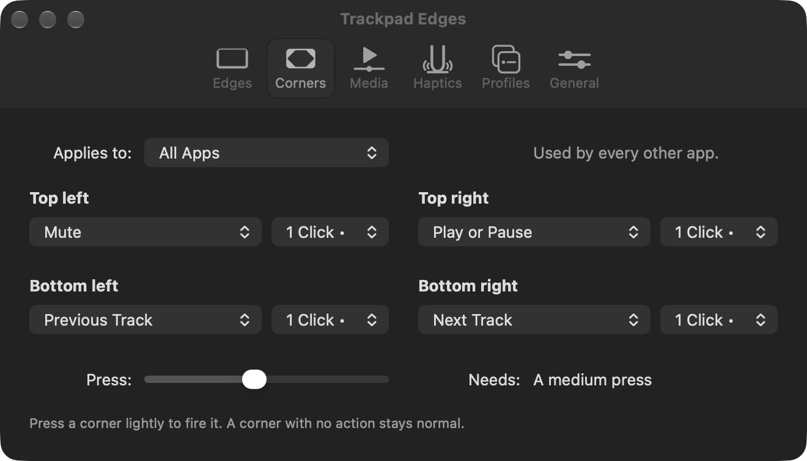
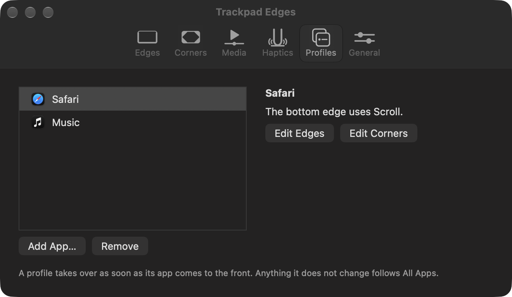
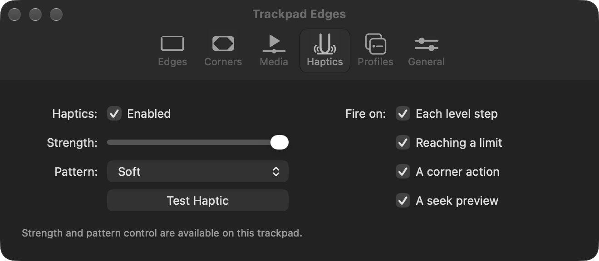
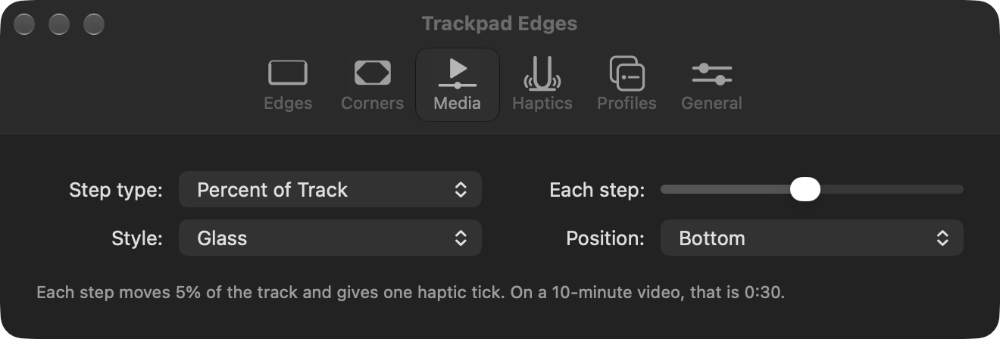
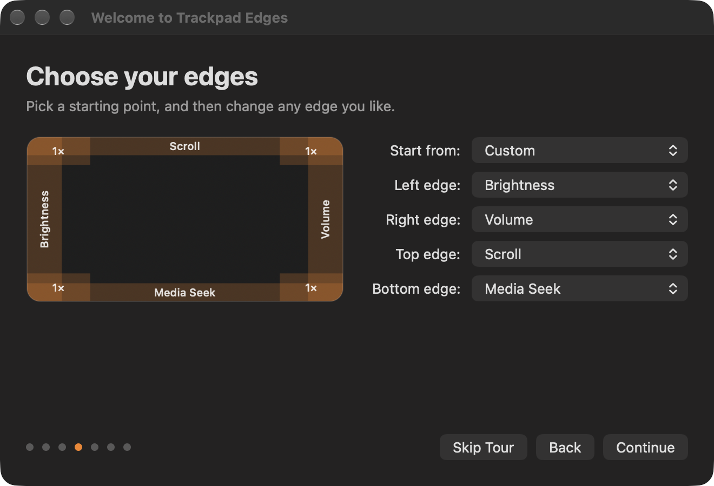

<p align="center">
  
</p>

<h1 align="center">Trackpad Edges</h1>

<p align="center">
  Turn the edges and corners of your Mac's trackpad into controls that you can feel.
</p>

<p align="center">
  <a href="https://trackpad.adiworks.dev"><strong>Website</strong></a>
  |
  <a href="#install"><strong>Install</strong></a>
  |
  <a href="CONTRIBUTING.md"><strong>Contribute</strong></a>
</p>

<a href="https://trackpad.adiworks.dev/assets/launch.mp4">
  
</a>

<p align="center"><a href="https://trackpad.adiworks.dev/assets/launch.mp4">Watch the film with sound</a></p>

Slide along the side of your trackpad to change the volume, the brightness, or your place in a video, and feel a tick on each step. Press a corner to run whatever you choose. The middle of the trackpad keeps working as it always has. A finger that lands on an edge is treated as the start of a slide, so the pointer waits, and a click there arrives when you let go.

## What it does

| Zone                               | How you use it         | What it can do                                                                                                                                                       |
| ---------------------------------- | ---------------------- | -------------------------------------------------------------------------------------------------------------------------------------------------------------------- |
| Left, right, top, and bottom edges | Slide along the edge   | Each edge can change the volume, brightness, or keyboard backlight, seek through media, scroll, zoom, or switch apps and Spaces. Monitor brightness is experimental. |
| The same edges with two fingers    | Slide with two fingers | Each edge can hold a second action, so one finger can change the volume and two fingers can zoom.                                                                    |
| All four corners                   | Press lightly          | A corner can mute, control media, open an app, link, or file, press a key combination, or run a shortcut. It can hold a different action for each number of presses. |
| The middle                         | Use it as usual        | Nothing changes here.                                                                                                                                                |

Controls move in fixed steps, so a slide goes as far as you expect, and a tap on an edge changes nothing. You can set how strong the haptic tick feels, or turn it off. The top-left corner mutes until you change it, and all testing so far has used built-in trackpads.

## A look around

Choose what each edge does, and watch your fingers on a live diagram of the trackpad.



Give each corner its own actions, and choose how firmly a corner needs a press.



Give an app its own edges and corners. A profile takes over when that app comes to the front, and anything it does not change follows your usual setup.



| Tune the haptics                                                                         | Set up media seek                                                             |
| ---------------------------------------------------------------------------------------- | ----------------------------------------------------------------------------- |
|  |  |

A new install opens a short tour that sets up the permission, your first slide, your edges, your corners, and your haptics.



## Requirements

- You need a Mac with Apple silicon and a Force Touch trackpad.
- The app needs macOS 13 or later. All testing so far has used macOS 27.2, so please report any problem on an earlier version.
- Gestures need the Accessibility permission, and the welcome tour helps you grant it. Quit the app before you remove it from that list.
- The app relies on private Apple frameworks, because no public API can read a trackpad from the background or control haptic strength. A macOS update could break it, and [docs/dependencies.md](docs/dependencies.md) lists every framework that it uses.

## Install

[Download Trackpad Edges for Mac](https://github.com/akar016012/trackpad-edges/releases/latest/download/TrackpadEdges.dmg), open the DMG, and drag the app to the Applications folder. The app is signed and notarized, so macOS only asks you to confirm the first time you open it. Versions after 1.0 check for updates every 24 hours and can install them for you, and you can turn that off in the General pane. Every version is also on the [Releases page](https://github.com/akar016012/trackpad-edges/releases).

You can also build the app from source with Xcode 27.2 or later. This command builds a signed Release copy and installs it in the Applications folder:

```bash
scripts/install.sh
```

The script looks for the project's Developer ID, and it falls back to your own Apple Development identity. Follow the signing step in [CONTRIBUTING.md](CONTRIBUTING.md) first, because media seek refuses a build signed by a team that it does not expect. The script does not notarize the app, so a build made this way is for your own Mac. An install by this script into the Applications folder has not been fully confirmed yet.

## Build and run

Choose your own team first, as [CONTRIBUTING.md](CONTRIBUTING.md) explains. Then open `trackpad-edges.xcodeproj` in Xcode and run the `trackpad-edges` scheme, or build from the command line with your team ID:

```bash
xcodebuild -project trackpad-edges.xcodeproj -scheme trackpad-edges -configuration Debug -derivedDataPath build DEVELOPMENT_TEAM=YOURTEAMID build
```

```bash
open "build/Build/Products/Debug/Trackpad Edges.app"
```

## Test

The gesture and settings logic has no system dependencies, so a small Swift package at the repository root covers it:

```bash
swift test
```

Touch hardware cannot be simulated, so changes to how gestures feel also need a try on a real trackpad.

## Documentation

- [docs/plan.md](docs/plan.md) lists what is done, what still needs a check, and what is planned next.
- [docs/gestures.md](docs/gestures.md) explains zones and how a slide starts.
- [docs/settings.md](docs/settings.md) describes every setting.
- [docs/dependencies.md](docs/dependencies.md) lists every framework and private API.
- [docs/releasing.md](docs/releasing.md) explains how releases are built.

## Contributing

Contributions are welcome, and [CONTRIBUTING.md](CONTRIBUTING.md) explains how to help. This project has one maintainer, so replies can take up to two weeks. Please report security problems privately, as [SECURITY.md](SECURITY.md) explains. Everyone who takes part agrees to follow the [code of conduct](CODE_OF_CONDUCT.md).

## License

Copyright (C) 2026 [Aditya Kar](https://adiportfolio.com/).

Trackpad Edges is free software: you can redistribute it and modify it under the terms of the [GNU General Public License version 3](LICENSE), and only that version (GPL-3.0-only). It is distributed in the hope that it will be useful, but without any warranty, and without even the implied warranty of merchantability or fitness for a particular purpose.

The parts that come from others keep their own licenses, which [THIRD_PARTY_NOTICES.md](THIRD_PARTY_NOTICES.md) lists. This project is independent, and it is not affiliated with Apple Inc.
